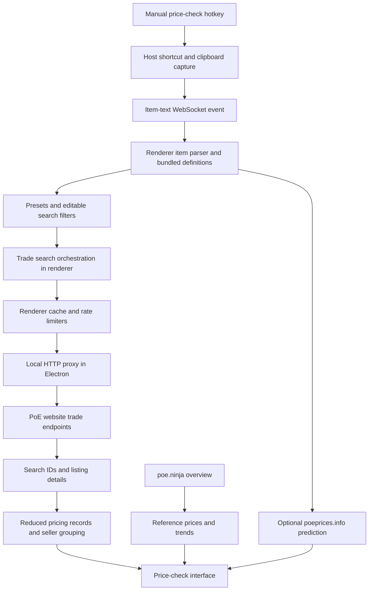

# Architecture

Reviewed on 2026-11-22 against upstream commit
[`2498730beecc1a46d39214ac437ffbe9f5f542d8`](https://github.com/SnosMe/awakened-poe-trade/commit/2498730beecc1a46d39214ac437ffbe9f5f542d8).
The application package at this baseline is version `3.30.102`.
This document describes existing behaviour; proposed changes are in
[fork development](./docs/fork-development.md).

## Application boundaries

This is a desktop Electron application, with a Vue interface that can also run
in a browser connected to its local host. It is primarily a PoE1 price-checking
and overlay tool. A fork does not add PoE2 support automatically.

| Location | Responsibility | Main entry points |
| --- | --- | --- |
| `main/src` | Electron lifecycle, native shortcuts, game-window attachment, clipboard, local files, HTTP proxy, updates | `main.ts`, `server.ts` |
| `renderer/src/parser` | Convert copied item descriptions into a structured item | `Parser.ts`, `ParsedItem.ts` |
| `renderer/src/assets/data` | Load and index bundled item/stat definitions and translations | `index.ts`, `interfaces.ts` |
| `renderer/src/web/background` | Browser-side host transport, leagues, poe.ninja prices | `IPC.ts`, `Leagues.ts`, `Prices.ts` |
| `renderer/src/web/price-check` | Presets, search filters, request construction, result display and predictions | `PriceCheckWindow.vue`, `CheckedItem.vue`, `trade/` |
| `renderer/src/web/overlay` | Widget registration, visibility, focus and layout | `OverlayWindow.vue`, `widget-registry.ts` |
| `ipc` | Shared TypeScript event contracts and key mappings | `types.ts`, `KeyToCode.ts` |
| `renderer/public/data` | Checked-in language-specific item/stat data and reference assets | `items.ndjson`, `stats.ndjson`, `client_strings.js` |
| `main/build`, `.github/workflows` | Bundling, native packaging patch, CI and documentation deployment | `script.mjs`, `main.yml`, `pages.yml` |

There is no root npm workspace or root package script. `main` and `renderer`
have separate package manifests, lockfiles and TypeScript versions. `docs` is a
separate VitePress project.

## Startup

1. `main/src/main.ts` obtains the single-instance lock, enables Electron's
   sandbox, creates host services and prepares shortcuts and the overlay.
2. `main/src/server.ts` starts HTTP and WebSocket services. Production defaults
   to a random port on `127.0.0.1`; development uses port `8584`.
3. The overlay loads the local application, or the development Vite server at
   `http://localhost:5173`. `--no-overlay` opens the interface in a browser.
4. `renderer/src/main.ts` loads configuration, translations and bundled game
   data, opens the WebSocket connection, then mounts Vue.
5. The overlay loads leagues, manages widgets and sends configured shortcuts
   and file locations to the host.

## Item-to-price flow

The shortcut copies the hovered item's description using the game's copy
action. `HostClipboard` briefly checks for the resulting item text. This is
initiated by the hotkey, rather than a background scan of all inventory items.
The baseline's copy-key helper accounts for PoE 3.29's advanced-description
change. Some older troubleshooting documents still describe the earlier keys.

`PriceCheckWindow.vue` receives `MAIN->CLIENT::item-text` and calls
`parseClipboard`. The parser processes ordered sections, resolves base items,
extracts properties and modifiers, and uses bundled translations/stat mappings.
It returns a `Result<ParsedItem, string>` with the original text retained.

`CheckedItem.vue` creates presets and chooses individual listings or the bulk
exchange route. Initial searches are automatic for certain item categories
according to settings; other searches wait for the user's interaction.
Consequently, one price-check hotkey does not always cause a trade search.

## Network sources and available output

| Source | Existing use | Important boundary |
| --- | --- | --- |
| Selected PoE website host, `/api/leagues` | League selection | Website endpoint, distinct from documented developer `/league` |
| `/api/trade/search/<league>` | Filtered item search returning query and result IDs | Listing discovery, not completed-sale history |
| `/api/trade/fetch/<ids>` | Listing details for returned IDs | The mapper retains only selected pricing/seller fields |
| `/api/trade/exchange/<league>` | Bulk offers, stock and exchange ratios | Trade-site offers, distinct from official hourly Currency Exchange history |
| poe.ninja dense overview | Category reference prices, currency conversion and graph data | Popular supported PC leagues; cached reference data, not a fresh exact-item quote |
| poeprices.info | Optional rare-item estimate and feedback | Sends transformed item text and selected league to a third party |
| Bundled `public/data` | Item identities, stat IDs, translations, drop data | Local reference data; not market data or an authenticated account feed |

The proxy has an allowlist of PoE website hosts, poe.ninja and poeprices.info.
It uses Electron's session cookies. No OAuth authorization flow, OAuth bearer
token storage, or character/stash API integration was found in the reviewed
application source. Availability of an individual request can depend on the
website session, protection challenges, network and provider policy.

`TradeListing.vue` fetches listing details in batches of ten. It starts with up
to twenty listings and may fetch further batches to fill grouped results, up
to the baseline's hundred-listing cap. The UI groups some repeated sellers.
This creates a sample for comparison, not a complete market dataset.

The raw fetch response can contain more information than the application
retains. `requestResults` maps it into a smaller `PricingResult` including
price, currency, seller identity/status and selected item properties. A future
feature that needs full comparable-item modifiers must define and retain those
fields at this boundary rather than infer them from the rendered table.

## Caching, throttling and ownership

The individual and bulk trade modules have separate in-memory `Cache`
instances. Their normal TTL is 300 seconds. Search entries use the request body
and league as their key; fetched listing entries use result IDs.

`common.ts` owns renderer-local SEARCH, EXCHANGE and FETCH limiter sets.
They begin conservatively and adjust from response rate-limit headers, with
a configurable latency allowance. Queue estimation rejects searches that would
create too much waiting. The HTTP proxy does not own a shared scheduler.

An additional browser tab or independent companion therefore does not
automatically share cache or limiter state with the original renderer. This is
the main architectural obstacle to treating the local server as a data API.

## Local transport and persistence

| Interface | Behaviour |
| --- | --- |
| `GET /config` | Returns application version, updater state and serialized configuration |
| WebSocket `/events` | Carries shared events, settings writes, host commands, item text and logs |
| `/proxy/<host>/<path>` | Forwards requests to allowlisted external hosts through Electron |
| `POST /uploads/<filename>` | Stores imported widget assets under a content-derived filename |
| `GET /uploads/<filename>` | Reads stored assets |
| Other production paths | Serve packaged renderer files |

Configuration is JSON in `apt-data/config.json` under Electron's `userData`
directory. Uploaded files use `apt-data/files`; optional OCR files use
`apt-data/cv-ocr`. The renderer upgrades configuration through versioned
migrations; the reviewed default is version 18. There is no application
database or durable trade-result history in this baseline.

The host can read the configured game log and game configuration file.
New game-log lines are broadcast to clients; the renderer parses chat and trade
whisper formats. A trade whisper is an expression of interest, not proof of a
completed sale.

## Build and release

The renderer builds first using Vue type checking and Vite. Its data plugin
generates ignored binary indices from checked-in NDJSON assets. The host then
runs TypeScript checking and esbuild, keeping native overlay/input modules
external. Electron Builder packages the two outputs together.

Upstream CI builds Windows, Linux and macOS packages. Its Linux AppImage patch
has a packaging assertion, but the repository has no general application test
script. Release identity and automatic updates still point to upstream
configuration. See [review findings](./docs/fork-review.md) before using a
packaged fork.
